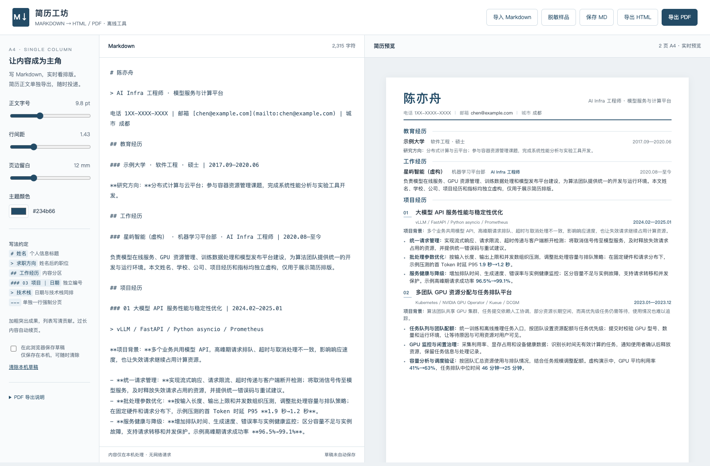

# 简历工坊 · Markdown Resume Tool

把 Markdown 写成排版清晰的 A4 简历，实时预览，一键导出独立 HTML，通过浏览器打印或命令行生成 PDF。

[](https://github.com/donghyq/markdown-resume-tool/actions/workflows/ci.yml)
[](LICENSE)

**[下载离线编辑器](https://github.com/donghyq/markdown-resume-tool/releases/latest/download/index.html)** · [完整工具包与版本](https://github.com/donghyq/markdown-resume-tool/releases) · [Markdown 样品](examples/sample.md) · [HTML 样品](examples/sample.html) · [PDF 样品](output/pdf/sample.pdf)



## 三步开始，无需安装

1. 下载上面的 `index.html`，用 Chrome 或 Edge 打开。它是一个完整的离线编辑器，不需要 Node.js、本地服务器或账号。
2. 修改中间的 Markdown，或点击“导入 Markdown”；右侧实时预览，左侧调整字号、行间距、留白和配色。
3. 点击“保存 MD”“导出 HTML”或“导出 PDF”。默认不自动保存，关闭页面前请保存源文件。

导出 PDF 会打开浏览器打印窗口，选择“另存为 PDF”。推荐 **A4、纵向、缩放 100%、页边距无、关闭页眉和页脚**，开启背景图形。若弹窗被阻止，请允许弹窗，或先导出 HTML，再打开文件点击“打印 / 导出 PDF”。其他浏览器的分页可能略有差异，请以最终打印预览为准。

## 能做什么

- Markdown 编辑、文件导入、实时预览；支持加粗、列表、链接、代码与表格。
- 单栏 A4 版式；项目编号独立显示，技术栈与日期同排，背景说明与贡献列表分层排版。
- 自动分页与手动分页，提供续页信息和页脚页码；超长单块显示警告，避免悄悄裁掉内容。
- 下载 Markdown 源文件和独立 HTML；浏览器另存 PDF，或通过命令行直接生成 PDF。
- 单文件离线运行；草稿保存可选，默认关闭，可随时清除本机草稿。
- 内置一份**完全虚构的 AI Infra 工程师样品**，覆盖模型 API、GPU 资源分配、训练数据处理、模型发布与监控。姓名、组织、经历和指标仅用于演示。

## Markdown 写法

```markdown
# 陈亦舟

> AI Infra 工程师

城市 成都 | 邮箱 [chen@example.com](mailto:chen@example.com)

## 工作经历

### 示例智能公司 · 模型平台部 · AI Infra 工程师 | 2020.08—至今

为算法团队提供统一的模型在线服务与 GPU 计算环境。

## 项目经历

### 01 提升模型 API 稳定性 | 2024.02—2025.01

> vLLM / FastAPI / Prometheus

**项目背景：**高峰期排队与超时影响请求响应。

- **个人贡献：**统一请求限流、超时和取消处理。
- **验证结果：**填写真实测量结果，并说明测试条件。

---

## 技术能力

- Python、Go、Kubernetes、模型服务与 GPU 资源管理。
```

| 写法 | 排版效果 |
| --- | --- |
| 第一个 `# 姓名` | 个人信息标题 |
| 紧随姓名的 `> 求职方向` | 与姓名同排的职位说明 |
| 接下来的一段文字 | 联系方式；用 ` | ` 或 ` · ` 分隔各项 |
| `## 工作经历` | 内容分区与细线标题 |
| `### 公司 · 部门 · 职位 \| 日期` | 公司信息与右侧日期，竖线两侧保留空格 |
| `### 01 项目名称 \| 日期` | 独立项目编号与项目标题 |
| 项目标题后紧接 `> 技术栈` | 技术栈与项目日期同排 |
| `**项目背景：**说明` | 背景段；中文标点后直接接正文也支持加粗 |
| `- **贡献：**说明` | 贡献条目与重点加粗 |
| 单独一行 `---` 或 `<!-- pagebreak -->` | 开始下一页 |

学校、公司等经历使用不带编号的三级标题；项目标题使用两位编号。项目整体优先同页，普通长列表可按条目分页。过长的单个项目、段落、列表条目或表格会提示拆分；字体和系统差异可能改变换行，请导出前检查。

## 命令行生成 HTML / PDF

需要 Node.js 20 或更新版本。在仓库目录运行：

```sh
git clone https://github.com/donghyq/markdown-resume-tool.git
cd markdown-resume-tool

# 仅生成 HTML，无需安装 npm 依赖
node cli.cjs examples/sample.md --html my-resume.html

# 直接生成 PDF：先安装一次可选依赖
npm ci
node cli.cjs examples/sample.md --html my-resume.html --pdf my-resume.pdf
```

工具会检测本机 Chrome / Edge；Linux 也会检测常见 Chromium 路径。没有可用浏览器时执行：

```sh
npx playwright install chromium
# Linux 若缺少浏览器系统依赖，可使用：
npx playwright install --with-deps chromium
```

也可用环境变量 `RESUME_CHROMIUM_PATH` 指定浏览器可执行文件。自定义排版：

```sh
node cli.cjs my-resume.md --html output/resume.html --pdf output/resume.pdf \
  --font-size 9.8 --line-height 1.43 --margin 12 --accent '#234b66'
```

不指定输出参数时，在输入文件旁生成同名 HTML。参数范围：字号 8–13 pt，基础行距 1.25–1.9，横向留白 9–20 mm；第二页采用更宽的默认行距。遇到超长单块时，命令行会保留 HTML 并停止 PDF 导出，提示拆分后重试。

## 内容与隐私

编辑与排版在本机完成，无需上传简历，也不依赖 CDN 或远程字体。Markdown 图片只显示替代文本，不会自动加载；原始 HTML 按普通文字显示。链接仅允许 HTTP(S)、邮箱、电话和页内锚点，用户点击外部链接时会访问对应网站。

默认不保存草稿。勾选“在此浏览器保存草稿”后，内容存入当前浏览器的 `localStorage`，可点击“清除本机草稿”。浏览器不支持文件页面存储时，请使用“保存 MD”。导出的文件由用户自行保存和分享。

## 开发与检查

```sh
npm ci
npm run build                # 从源码重新生成单文件编辑器
npm run sample               # 从样品 Markdown 重新生成 HTML
npm run check                # 解析与安全测试、构建产物一致性检查
npx playwright install chromium
npm run test:browser         # 导入、下载、打印入口、草稿、分页与手机布局
```

浏览器测试可同样设置 `RESUME_CHROMIUM_PATH`。持续集成会安装中文字体，在 Linux Chromium 上检查浏览器行为和命令行 PDF 导出。

| 文件 | 用途 |
| --- | --- |
| `index.html` | 可复制、直接打开的离线编辑器 |
| `src/editor.html` | 编辑器模板 |
| `src/core.cjs` | 浏览器与命令行共用的解析、渲染和分页代码 |
| `src/reference.css` | A4 简历模板样式 |
| `build.cjs` / `cli.cjs` | 构建与命令行导出 |
| `examples/` | 虚构 Markdown / HTML 样品 |
| `output/` | 样品 PDF 与局部排版预览 |
| `tests/` | 解析与浏览器验证；参考样式对照检查需要自行提供参考 HTML |
| `vendor/` | 随工具提供的 Markdown 解析库和许可证 |

## 许可证

工具代码与模板采用 [MIT 许可证](LICENSE)。内置 Marked 17.0.5 的第三方许可见 [vendor/LICENSE-marked.md](vendor/LICENSE-marked.md)；单文件编辑器也包含许可证文本。
